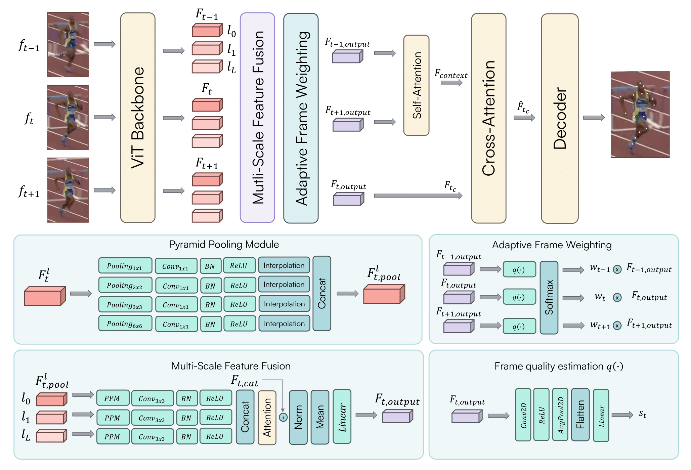

# Poseidon: A ViT-based Architecture for Multi-frame Pose Estimation with Adaptive Frame Weighting and Multi-Scale Feature Fusion

This repository is the official implementation for **Poseidon: A ViT-based Architecture for Multi-frame Pose Estimation with Adaptive Frame Weighting and Multi-scale Feature Fusion** by Cesare Davide Pace.

[](https://paperswithcode.com/sota/multi-person-pose-estimation-on-posetrack2018?p=poseidon-a-vit-based-architecture-for-multi)

[](https://paperswithcode.com/sota/multi-person-pose-estimation-on-posetrack21-1?p=poseidon-a-vit-based-architecture-for-multi)

[](https://paperswithcode.com/sota/2d-human-pose-estimation-on-jhmdb-2d-poses?p=poseidon-a-vit-based-architecture-for-multi)

[**Read the paper on arXiv**](https://arxiv.org/pdf/2501.08446)

## Abstract

Human pose estimation, a vital task in computer vision, involves detecting and localizing human joints in images and videos. While single-frame pose estimation has seen significant progress, it often fails to capture the temporal dynamics for understanding complex, continuous movements. We propose **Poseidon**, a novel multi-frame pose estimation architecture that extends the ViTPose model by integrating temporal information for enhanced accuracy and robustness to address these limitations. Poseidon introduces key innovations: (1) an Adaptive Frame Weighting (AFW) mechanism that dynamically prioritizes frames based on their relevance, ensuring that the model focuses on the most informative data; (2) a Multi-Scale Feature Fusion (MSFF) module that aggregates features from different backbone layers to capture both fine-grained details and high-level semantics; and (3) a Cross-Attention module for effective information exchange between central and contextual frames, enhancing the model’s temporal coherence. The proposed architecture improves performance in complex video scenarios and offers scalability and computational efficiency suitable for real-world applications.
Our approach achieves state-of-the-art performance on the PoseTrack21 and PoseTrack18 datasets, achieving mAP scores of 88.3 and 87.8, respectively, outperforming existing methods.



### Quantitative Results on the PoseTrack18 Dataset

| Method            | Head  | Shoulder | Elbow | Wrist | Hip   | Knee  | Ankle | **Mean** |
|-------------------|-------|----------|-------|-------|-------|-------|-------|----------|
| PoseWarper        | 79.9  | 86.3     | 82.4  | 77.5  | 79.8  | 78.8  | 73.2  | 79.7     |
| DCPose            | 84.0  | 86.6     | 82.7  | 78.0  | 80.4  | 79.3  | 73.8  | 80.9     |
| DetTrack          | 84.9  | 87.4     | 84.8  | 79.2  | 77.6  | 79.7  | 75.3  | 81.5     |
| FAMI-Pose         | 85.5  | 87.8     | 84.2  | 79.2  | 81.4  | 81.1  | 74.9  | 82.2     |
| DiffPose          | 85.0  | 87.7     | 84.3  | 81.5  | 81.4  | 82.9  | 77.6  | 83.0     |
| DSTA              | 85.9  | 88.8     | 85.0  | 81.1  | 81.5  | 83.0  | 77.4  | 83.4     |
| TDMI-ST           | 86.7  | 88.9     | 85.4  | 80.6  | 82.4  | 82.1  | 77.6  | 83.6     |
| JM-Pose           | 90.7  | 91.6     | 87.8  | 82.1  | 85.9  | 85.3  | 79.2  | 84.1     |
| **Poseidon (Ours)** | **88.8** | **91.4** | **88.6** | **86.3** | **83.3** | **88.8** | **87.2** | **87.8** |

### Quantitative Results on the PoseTrack21 Dataset

| Method            | Head  | Shoulder | Elbow | Wrist | Hip   | Knee  | Ankle | **Mean** |
|-------------------|-------|----------|-------|-------|-------|-------|-------|----------|
| Tracktor++ w. poses | -     | -        | -     | -     | -     | -     | -     | 71.4     |
| CorrTrack         | -     | -        | -     | -     | -     | -     | -     | 72.3     |
| CorrTrack w. ReID | -     | -        | -     | -     | -     | -     | -     | 72.7     |
| Tracktor++ w. corr. | -     | -        | -     | -     | -     | -     | -     | 73.6     |
| DCPose            | 83.2  | 84.7     | 82.3  | 78.1  | 80.3  | 79.2  | 73.5  | 80.5     |
| FAMI-Pose         | 83.3  | 85.4     | 82.9  | 78.6  | 81.3  | 80.5  | 75.3  | 81.2     |
| DiffPose          | 84.7  | 85.6     | 83.6  | 80.8  | 81.4  | 83.5  | 80.0  | 82.9     |
| DSTA              | 87.5  | 87.0     | 84.2  | 81.4  | 82.3  | 82.5  | 77.7  | 83.5     |
| TDMI-ST           | 86.8  | 87.4     | 85.1  | 81.4  | 83.8  | 82.7  | 78.0  | 83.8     |
| JM-Pose           | 85.8  | 88.1     | 85.7  | 82.5  | 84.1  | 83.1  | 78.5  | 84.0     |
| **Poseidon (Ours)** | **92.2** | **90.8** | **88.3** | **85.8** | **85.5** | **87.7** | **85.7** | **88.3** |

Evaluation is performed using the official PoseTrack evaluation code, poseval, which uses py-motmetrics internally.

## Environment

* Python version:  3.11.6

* PyTorch version:  2.0.1

* Cuda version: 12.0

```bash
conda create -n poseidon pyhton=3.11.6
conda activate poseidon

pip install -U openmim

conda install pytorch==2.0.1 torchvision==0.15.2 torchaudio==2.0.2 pytorch-cuda=11.8 -c pytorch -c nvidia

mim install mmengine 
mim  install "mmcv==2.1.0"
mim  install "mmdet==3.2.0"
mim  install "mmpose==1.3.1"
mim  install "mmpretrain==1.2.0"

cd poseidon
conda env update --file environment.yml

```

for further details regarding the installation of MMPose refer to [**MMPose install**](https://mmpose.readthedocs.io/en/latest/installation.html)

## Data preparation

### Sub-JHMDB Datset

The directory stucture must be:

```text
dataJHMDB/
    -- annotations/
        -- split1/
            -- train/
            -- val/
        -- split2
        -- split3
    -- images/Rename_Images/
    -- jsons/
        -- split1/
            -- val.json
            -- train.json
        -- split2/
        -- split3/
```

The dataset can be downloaded from [**JHMDB Site**](http://jhmdb.is.tue.mpg.de) and the annotations from [**MMPose Source**](https://mmpose.readthedocs.io/en/latest/dataset_zoo/2d_body_keypoint.html)

Once the annotations have been downloaded, use add_crown.py for each annotations file to adapt the format to coco format and rename it with "posetrack_train.json" or "posetrack_val.json".

```bash
python notebook/add_crown.py --file_path dataJHMDB/jsons/split1/Sub1_train.json
# remember to rename the file
```

After this, use separeta_json.py to generate json files for each frame.

```bash
python separate_json.py --input_file dataJHMDB/jsons/split1/posetrack_val.json --output_folder dataJHMDB/annotations/split1/val
```

### Posetrack18 and Posetrack21

The dataset can be downloaded from [**Posetrack download**](https://github.com/anDoer/PoseTrack21) and the structure of the dataset must be:

```
dataPosetrack18/
    -- annotations/
        -- train/
        -- val/
    -- images/
        -- train/
        -- val/
    -- json/
        -- posetrack_train.json
        -- posetrack_val.json
```

```
dataPosetrack21/
    -- annotations/
        -- train/
        -- val/
    -- images/
        -- train/
        -- val/
    -- json/
        -- posetrack_train.json
        -- posetrack_val.json
```

## Pretrained Weights for ViTPose

The pretrained weights for ViTPose can be downloaded from the [MMPose Model Zoo](https://mmpose.readthedocs.io/en/latest/model_zoo/body_2d_keypoint.html). Pretrained models must be placed in the models/vitpose/ folder.

## Poseidon Weights & Reproduction Guide

Trained Poseidon checkpoints are available on Google Drive:
<https://drive.google.com/drive/folders/1i7UwEF45bnwTMO8bwD3UForeb45-bEaX?usp=share_link>

The table below maps each reported result to the exact config and checkpoint needed to reproduce it. All models use a temporal window of **5 frames** (`WINDOWS_SIZE: 5`) and ground-truth boxes on the validation set (`USE_GT_BBOX: true`). **Before running, edit the dataset paths (`DATASET.JSON_DIR`, `DATASET.IMG_DIR`, `VAL.ANNOT_DIR`, ...) in the config to point to your local data.** The `configs/best*` folders contain the configurations used for the paper.

| Paper result | Config | Checkpoint |
|---|---|---|
| PoseTrack21, ViT-H (mAP 88.3, main result) | `configs/bestposetrack21/configPoseidonVitH.yaml` | `vith_model.pt` |
| PoseTrack21, ViT-B (mAP 84.6) | `configs/bestposetrack21/configPoseidonVitB.yaml` | `vitb_model.pt` |
| PoseTrack21, ViT-S (mAP 81.7) | `configs/bestposetrack21/configPoseidonVitS.yaml` | `vits_model.pt` |
| PoseTrack18, ViT-H (mAP 87.8) | `configs/bestposetrack18/configPoseidonVitH.yaml` | `vith_model_posetrack18.pt` |
| Sub-JHMDB (mean PCK 97.3, no fine-tuning) | `configs/bestJHMDB/split{1,2,3}/configPoseidonVitH.yaml` | `vith_model.pt` (PoseTrack21 model, tested directly) |

> The ViT-L configuration (`configs/bestposetrack21/configPoseidonVitL.yaml`) is provided so the model can be retrained; its checkpoint is not part of the release.

Place the downloaded checkpoints under `models/` (or pass their path via `--weights_path` / `-w`).


## Usage
Use the configs in the `configs/best*` folders (these reproduce the paper — see the Reproduction Guide above). **Remember to set the dataset paths inside the chosen config file** before running.

### Training

```bash
python train.py --config configs/bestposetrack21/configPoseidonVitH.yaml
```

### Validation

```bash
python val.py --config configs/bestposetrack21/configPoseidonVitH.yaml --weights_path models/vith_model.pt
```

### AFW frame-weight diagnostics

The diagnostic script visualizes the five learned AFW coefficients on a shared,
zero-based scale with the uniform `1/T` reference. It also exports the exact
values to CSV:

```bash
python visualize_frame_weights.py \
  --config configs/bestposetrack21/configPoseidonVitH.yaml \
  --weights models/vith_model.pt \
  --data-root /path/to/PoseTrack21 \
  --frames 5 \
  --images \
    images/val/020031_mpii_test/000075.jpg \
    images/val/003943_mpii_test/000044.jpg \
    images/val/018896_mpii_test/000062.jpg \
  --labels "Wrist sequence" "Elbow sequence" "Knee sequence" \
  --out output/appendix_frame_weights.png
```

The batch-one qualitative comparison in Appendix B can be reproduced with:

```bash
python qualitative_comparison.py \
  --config configs/bestposetrack21/configPoseidonVitH.yaml \
  --weights models/vith_model.pt \
  --data-root /path/to/PoseTrack21 \
  --images \
    images/val/020031_mpii_test/000075.jpg \
    images/val/018896_mpii_test/000062.jpg \
    images/val/023754_mpii_test/000102.jpg \
  --joints 9 13 9 \
  --labels "Wrist success" "Knee success" "Occlusion failure" \
  --out output/appendix_comparison.png
```

This figure uses independently applied COCO-pretrained ViTPose as a qualitative
per-frame reference. The controlled single-frame comparison is the ablation
reported in the paper.

### Inference  🚀 *(early-stage — contributions welcome!)*

This is **the very first release** of Poseidon’s inference pipeline; we expect to refine and optimise it over time, so **feel free to open issues or pull-requests with improvements**.

#### Quick start

You must setup the environment similarly for training and validation.

#### Using Conda

```bash
conda create -n poseidon pyhton=3.11.6
conda activate poseidon

pip install -U openmim

conda install pytorch==2.0.1 torchvision==0.15.2 torchaudio==2.0.2 pytorch-cuda=11.8 -c pytorch -c nvidia

cd poseidon
conda env update --file environment.yml
```

### Using Pip

```bash
python -m venv .venv
source .venv/bin/activate
pip install --upgrade pip

pip install -U openmim
pip install pytorch==2.0.1 torchvision==0.15.2 torchaudio==2.0.2 pytorch-cuda=11.8 -c pytorch -c nvidia
pip install torch torchvision torchaudio
pip install ultralytics
pip install opencv-python pyyaml numpy
python -m ensurepip --upgrade
python -m pip install --upgrade setuptools
```

### MIM for PyTorch 2.0.1 and torchvision==0.15.2

```bash
mim install mmengine
mim install "mmcv==2.1.0"
mim install "mmdet==3.2.0"
mim install "mmpose==1.3.1"
mim install "mmpretrain==1.2.0"
```

1. **Install YOLO’s runtime.**  
   We rely on the Ultralytics implementation; grab it with:

   ```bash
   pip install ultralytics           # YOLO v8.x
    ```

2. **Download the VitPose model.**  
   We rely on the ViTPose implementation; grab it with:
   `mim download mmpose --config td-hm_ViTPose-huge_8xb64-210e_coco-256x192 --dest ./models/vitpose`
    The destination folder should be models/vitpose

3. **Download the pre-trained Poseidon weights**:  
   <https://drive.google.com/drive/folders/1i7UwEF45bnwTMO8bwD3UForeb45-bEaX?usp=share_link>

4. **Run inference** — the script automatically performs *person detection* with **YOLO v8-s** (this version is hard-coded in the script, but you can swap in other YOLO models if you wish):

   ```bash
   python inference.py \
          -c configs/bestposetrack21/configPoseidonVitH.yaml \
          -w models/vith_model.pt \
          -i input/sample_video.mp4 \
          -o output/sample_annotated.mp4 \
          --window 5 \
          --step 1 \
          --gpu 0 \
          --coco_json results/sample_keypoints.json
    ```

## Citations

```
@misc{pace2025poseidonvitbasedarchitecturemultiframe,
      title={Poseidon: A ViT-based Architecture for Multi-Frame Pose Estimation with Adaptive Frame Weighting and Multi-Scale Feature Fusion}, 
      author={Cesare Davide Pace and Alessandro Marco De Nunzio and Claudio De Stefano and Francesco Fontanella and Mario Molinara},
      year={2025},
      eprint={2501.08446},
      archivePrefix={arXiv},
      primaryClass={cs.CV},
      url={https://arxiv.org/abs/2501.08446}, 
}
```

## Acknowledgment

Our codes are mainly based on [**DCPOSE**](https://github.com/Pose-Group/DCPose) and [**MMPose**](https://mmpose.readthedocs.io/en/latest/). Thanks to the authors!
